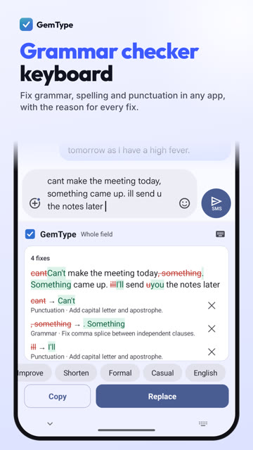
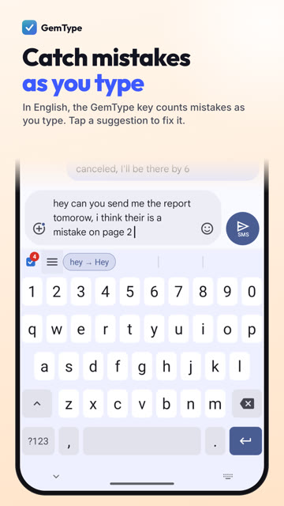
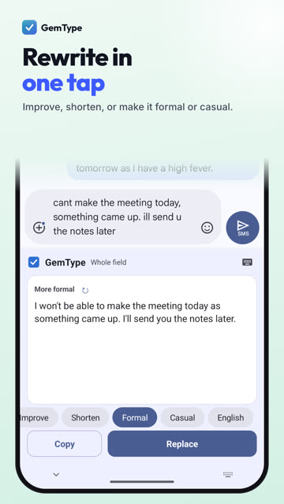
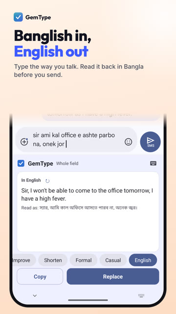
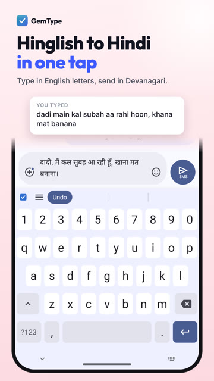
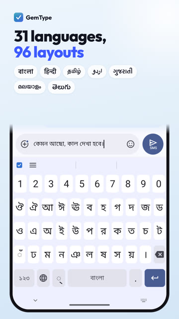

<div align="center">



# GemType: AI Grammar Checker Keyboard for Android

**Fix grammar, spelling and punctuation in any app, rewrite your tone in one tap, and type in 31 languages. Free, open source, and powered by your own Google Gemini API key.**

<a href="https://play.google.com/store/apps/details?id=org.matily.gemtype"></a>
<a href="https://github.com/MatilyLabs/GemType-Keyboard/releases/latest"></a>

[](https://github.com/MatilyLabs/GemType-Keyboard/stargazers)
[](https://github.com/MatilyLabs/GemType-Keyboard/releases)
[](https://github.com/MatilyLabs/GemType-Keyboard/releases/latest)
[](#install)
[](LICENSE)

[Website](https://gemtype.matily.org) · [Features](#features) · [Install](#install) · [FAQ](#faq) · [GemType for browsers](#gemtype-for-chrome-edge-and-firefox)

</div>

---

GemType is a grammar checker keyboard for Android. It checks and corrects your writing right where you type it, in messages, email, notes, social apps and the browser, explains every fix, and rewrites your text in one tap. It is a full keyboard with 31 languages, and it sends text only to Google's Gemini API with your own key. There are no GemType servers, no ads and no analytics.

<div align="center">



<br/>



</div>

## Features

### Grammar checker in every app
- Tap the GemType key to check what you wrote. Each fix is marked grammar, spelling, punctuation or style, with a short reason.
- Keep the fixes you want, skip the rest, then tap Replace. Undo is one tap away.
- **Check as you type** (English): after you pause, the GemType key shows how many mistakes it found. Tap the suggestion to apply a fix.

### Rewrite in one tap
- Improve, Shorten, Formal or Casual.
- Ask for another version and compare versions before you replace your text.

### Type the way you talk
- Write Bangla, Hindi and other languages in English letters (Banglish, Hinglish) and convert them to the language's own script with one tap.
- Translate what you wrote into clear English. A "Read as" line shows the meaning back in your language, so you know what you are sending.

### A full keyboard in 31 languages
- 96 layouts in 21 scripts, gesture typing, next-word prediction in 20 languages, predictive transliteration (type "namaste", get नमस्ते), clipboard history, themes and emoji search.

### Fix text from other apps
- Select text in many apps and choose GemType from the menu, or share text to GemType.
- The **Fix clipboard** tile in Quick Settings corrects text you copied.

### Private by design
- Your typing stays on your phone. Text is sent only when you tap GemType, or while check as you type is on for English, and it goes directly to Google's Gemini API with your key.
- Your API key is stored encrypted on your device and is left out of backups.
- No ads, no analytics, no accounts, no GemType servers. [Privacy policy](https://gemtype.matily.org/privacy).

## Install

1. Install GemType from [Google Play](https://play.google.com/store/apps/details?id=org.matily.gemtype), or download the APK from [Releases](https://github.com/MatilyLabs/GemType-Keyboard/releases/latest).
2. Open GemType and follow the setup: turn it on as your keyboard, then switch to it.
3. Get a free Gemini API key at [aistudio.google.com](https://aistudio.google.com/apikey) and paste it into GemType.
4. Start typing in any app and tap the GemType key.

Free Gemini keys have per-minute and daily limits. If fixes stop for a while, wait and try again, switch the model to Flash-Lite in GemType settings, or turn on billing for your key in Google AI Studio.

## Languages

Arabic, Assamese, Bangla (Bengali), Bhojpuri, Burmese, English, Gujarati, Hindi, Ho, Kannada, Kashmiri, Konkani, Maithili, Malayalam, Manipuri (Meitei), Marathi, Mon, Nepali, Odia, Punjabi, Rohingya, Sanskrit, Santali, Saurashtra, Sindhi, Sinhala, Sylheti, Tamil, Telugu, Tulu and Urdu.

## FAQ

**Is GemType free?**
Yes. GemType is free and has no ads. It uses your own Gemini API key, and Google AI Studio offers a free tier.

**What is a grammar checker keyboard?**
A keyboard that checks and corrects your writing where you type it, so you never copy text into a separate app.

**Which languages does the grammar check support?**
Check as you type works in English. Tapping GemType fixes and rewrites text in many languages, including Bangla and Hindi.

**Can it change the tone of a message?**
Yes. Make a message more formal for work, more casual for friends, shorter, or simply clearer.

**Does GemType see what I type?**
GemType has no servers. Text leaves your phone only when you tap GemType or while check as you type is on, and it goes directly to Google's Gemini API.

**Why did fixes stop working?**
Free Gemini keys have per-minute and daily limits. Wait a minute, switch to Flash-Lite, or turn on billing for your key in Google AI Studio.

## GemType for Chrome, Edge and Firefox

The same grammar checker for your browser, Microsoft Word and the desktop: [**riponcm/GemType**](https://github.com/riponcm/GemType)

[](https://chromewebstore.google.com/detail/linnnamnhkciekgpnegkcajcafmjlhgh)
[](https://chromewebstore.google.com/detail/linnnamnhkciekgpnegkcajcafmjlhgh)
[](https://github.com/riponcm/GemType/stargazers)

[Chrome](https://chromewebstore.google.com/detail/linnnamnhkciekgpnegkcajcafmjlhgh) · [Edge](https://microsoftedge.microsoft.com/addons/detail/edbehlnmfcjhlbdlnmklicdoaopobbel) · [Firefox](https://addons.mozilla.org/firefox/addon/gemtype-ai-writing-assistant/)

## Build from source

Requirements: JDK 17, the Android SDK and NDK, and Go (for the transliteration engine).

```bash
git clone --recursive https://github.com/MatilyLabs/GemType-Keyboard.git
cd GemType-Keyboard
cp .env.sample .env    # set ANDROID_SDK, NDK_VERSION and JAVA_HOME
make build             # debug APKs in java/build/outputs/apk/online/debug/
make run               # install on a connected device and make GemType the active keyboard
```

Run `make` to list every command.

## Support

Questions, bugs or a wrong result: open an [issue](https://github.com/MatilyLabs/GemType-Keyboard/issues), use **Settings › About › Report a problem** in the app, or email support@matily.org.

## Credits and license

GemType is made by [Matily](https://matily.org) and developed by Ripon C. Malo.

It is built on the open-source [Indic Keyboard](https://github.com/smc/Indic-Keyboard) by Jishnu Mohan and contributors, which is based on the Android Open Source Project keyboard. Predictive transliteration by [Varnam](https://github.com/varnamproject), layouts from jquery.ime, and word lists from Wikipedia and Olam/Alar. Thank you to everyone who built them.

GemType is licensed under the [GNU Affero General Public License v3.0 or later](LICENSE). Code from Indic Keyboard and the Android Open Source Project remains under the [Apache License 2.0](LICENSE-APACHE).
